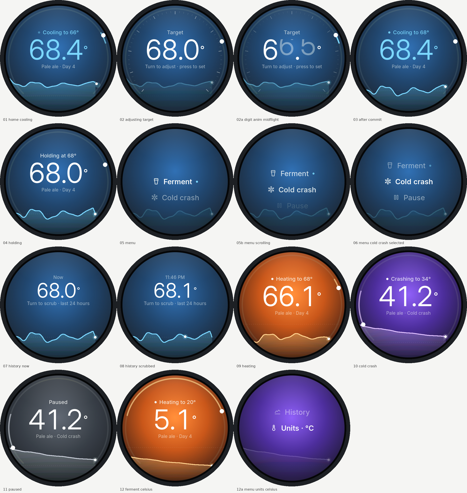

# Brewdial: round fermentation controller UI (LVGL 9)

This is an LVGL 9 implementation of the round "crown" UI from the mockup, for round panels with a rotary rim, plus the fermentation controller behind it. **Flashing the Elecrow CrowPanel 2.1" (480×480): see [`boards/crowpanel21/README.md`](boards/crowpanel21/README.md).** A prebuilt image (from the GitHub releases) can be flashed from the browser. Firmware builds with PlatformIO; LVGL 9.3.

The screen, the link between display and controller (same chip, UART, ...), and the sensors and relays are all swappable behind small interfaces. [`CLAUDE.md`](CLAUDE.md) has the layering and wire-format rules; `tools/check_rules.py` enforces them on every build.



## Layout

```
lib/
  brew_hal/            interfaces: DisplayPanel, Touch, Encoder, DigitalIn/Out, I2cBus, ByteStream,
                       TempSensor, SettingsStore, Link
  brew_core/           portable logic: Controller, control laws, OutputGuard, KnobInput, codec,
                       COBS/CRC framing, LocalBus, remote proxies, FakePlant (demo fermenter)
  brew_drivers/        portable chip drivers on hal buses: PCF8574, MCP23008, CST8xx touch
  brew_drivers_esp32/  ESP-IDF drivers: I2C, GPIO, PCNT encoder, LEDC backlight, esp_lcd RGB + QSPI
                       panels, UART, NVS, DS18B20
  brew_ui/             the UI (C): brew_model (state + rules, no LVGL) drawn by a layout
                       (layout_round: ring, digit animation, menu wheel, history scrub)
  brew_fonts_<size>/   Inter (weights 360/450/560) + Tabler icons, per panel size (360, 480)
  brew_app/            UiBridge (brew_ui <-> controller), LVGL port, ESP32 display runtime
boards/                one folder per board: pins + which drivers (the only board-specific code)
  crowpanel21/         Elecrow CrowPanel 2.1" (480)
  controller_devkit/   headless controller (probe + relays) for a two-board setup over UART
  waveshare_knob18/    Waveshare 1.8" knob (360), pins TODO, unverified
proto/brewdial.proto   schema of record for display <-> controller messages
sim/                   host build: web test harness (sim/web, sim/harness), brew_desk (SDL window),
                       brew_sim (headless -> PNG), brew_bench, brew_tests, harness_check
test/                  unit tests (controller, knob ordering, codec golden bytes, framing, drivers)
tools/                 gen_fonts.sh, check_rules.py
```

### How the pieces talk

```
 sensors ─► Controller ─► OutputGuard ─► relays          (control task)
               ▲   │
         Command   State / History        LocalBus (same chip) or UART link (two boards)
               │   ▼
 knob/touch ─► UiBridge ─► brew_ui (LVGL)                 (input + UI tasks)
```

The UI side and the controller side only exchange `Command` / `State` / `HistoryChunk` through `UiPort` / `ControlPort`. On one board that is a lock-free `LocalBus`; across boards it is `RemoteControllerProxy` / `RemoteUiProxy` over any `hal::Link` (UART framing is built in). Firmware environments in `platformio.ini`:

| Env                   | What it is                                                         |
|-----------------------|--------------------------------------------------------------------|
| `crowpanel21`         | CrowPanel: display + controller on one board (default)             |
| `crowpanel21_display` | CrowPanel as a display only, talking to a controller over UART     |
| `controller_devkit`   | Headless controller on any ESP32-S3 dev board (probe + 2 relays)   |
| `waveshare_knob18`    | Waveshare 1.8" knob (unverified: pins and panel init are TODO)     |

## UI API (`brew_ui.h`)

The UI is a pure view. `UiBridge` (lib/brew_app) drives it from the controller's `State`, so you normally don't call this directly. Every temperature that crosses this API is in °F; the UI handles unit display itself.

```c
brew_ui_create(lv_screen_active(), &(brew_ui_cbs_t){ on_setpoint, on_mode, on_units, NULL });
brew_ui_set_setpoints(66, 34);
brew_ui_set_history(samples, n, 30);   // oldest first, minutes per sample
brew_ui_set_temp(68.4f);               // call every couple of seconds
brew_ui_set_action(BREW_ACTION_COOLING);
brew_ui_push_history(t);               // every N minutes

brew_ui_encoder(+1);                   // per detent, from your knob driver
brew_ui_press();                       // knob push (taps on the screen already call this)
```

The controller decides cooling, heating and idle: a `ControlLaw` proposes and `OutputGuard` enforces the interlock, per-relay minimum on/off times (cool min off doubles as the compressor delay, counted from power-up too) and the heat↔cool gap before the relays switch. Boards use `ChamberDefaults` (in `brew/control.h`): `HysteresisLaw` with 0.5 °F heat and cool differentials (heat comes on at target − 0.5 and runs to the target, like an Inkbird's HD/CD), a 5 min compressor delay and a 10 min heat↔cool gap. The old ±0.3 °F `DeadbandLaw` is still there; the web harness compares the two. The UI only shows the result: it picks the background (blue, orange, purple or grey), the status sentence, and whether the text is blue.

### Model and layouts

`brew_ui` is split so the same product can have different screens:

- **`brew_model.c`**: everything the UI knows and decides. That's readings, targets, history, which view is open, the target being adjusted, the menu and scrub position, the 2.8 s auto-save, the status sentence, and the time labels. There's no LVGL here; it's unit-tested on its own (`test/test_ui_model.cpp`), and `check_rules.py` keeps it that way.
- **A layout** (`brew_layout.h`) draws the model and nothing else. `layout_round.c` is the dial. A square panel with buttons, or a rectangular one, is another `brew_layout_t`, created with `brew_ui_create_with_layout()`. Layouts route taps and buttons to `brew_ui_press()` / `brew_ui_encoder()`, so every layout behaves identically.
- **`brew_ui.c`**: the public API. It forwards each call to the model and the resulting `BREW_CH_*` change flags to the layout, and runs the auto-save timer.

Behaviour changes go in the model; looks go in a layout.

## Interaction

| Screen  | Turn the crown                                                     | Press                     |
|---------|--------------------------------------------------------------------|---------------------------|
| Home    | Adjusts the target. Ticks appear; it saves after 2.8 s of idle     | Opens the menu            |
| Adjust  | ±0.5° per detent, in whichever unit is shown                       | Saves now                 |
| Menu    | Scrolls Ferment / Cold crash / Pause / History / Units             | Selects the item          |
| History | Scrubs the background graph through the stored samples             | Returns home              |

## How it's built

- **Background.** The background is drawn per pixel (`brew_bg_render`) rather than with LVGL's gradient engine, so it matches the CSS exactly: a farthest-corner radial gradient centred at 50%/40%, plus the glass highlight. It's ordered-dithered to RGB565, which avoids visible banding in the dark blue-grey. Two canvases cross-fade over 700 ms when the state changes.
- **Graph.** The graph has its own ARGB8888 canvas, so it can be dimmed while you adjust (40%) or use the menu (25%) without being re-rendered. The fill is drawn per pixel with an anti-aliased top edge. The line uses LVGL's AA line drawing over the same Catmull-Rom curve as the mockup.
- **Digits.** Each character sits in its own fixed-width cell, which gives tabular digits. When the value changes, only the cells whose character changed animate: a 260 ms slide-and-fade, upward when the value rises and downward when it falls.
- **Memory.** About 720 KB of canvases (2 × 253 KB backgrounds + 197 KB graph). Define `BREW_UI_ALLOC` so they land in PSRAM; the ESP32 port already does this.

## Iterating on your machine

You don't need the board to work on the UI. `sim/` builds the same C files against desktop LVGL in RGB565, the panel's pixel format, so what you see is what the panel shows.

### Web test harness (start here)

```powershell
powershell -File tools/web.ps1
```

This opens the display and controller firmware in your browser, running on simulated hardware. You can:
- turn and press the knob, or touch the screen;
- drag the beer temperature, fake probe faults, and watch the heat/cool relays;
- speed time up to ×3600;
- switch the control law or the compressor-protection times;
- run display and controller as two boards over a lossy simulated cable.

Setup and details are in [sim/web/README.md](sim/web/README.md). The tools below are the older native ones.

### One-time setup

```sh
# macOS
brew install cmake sdl2
# Ubuntu / Debian
sudo apt install build-essential cmake libsdl2-dev
```

**Windows (native, recommended):** install [MSYS2](https://www.msys2.org), open the **MSYS2 UCRT64** shell, and run:

```sh
pacman -S --needed git mingw-w64-ucrt-x86_64-gcc mingw-w64-ucrt-x86_64-cmake \
    mingw-w64-ucrt-x86_64-ninja mingw-w64-ucrt-x86_64-SDL2 mingw-w64-ucrt-x86_64-python-pillow
```

Then follow the steps below inside that shell, adding `-G Ninja` to the first `cmake` line. You get a native `brew_desk.exe`. If you launch it from Explorer instead of the shell, copy `SDL2.dll` from `C:\msys64\ucrt64\bin` next to it.

**Windows (WSL2):** the Ubuntu steps work as-is, and WSLg shows the window. For flashing the ESP32 it's simpler to use Espressif's native Windows ESP-IDF installer or the VS Code ESP-IDF extension. WSL can't see USB without `usbipd`.

Then, from the repo root:

```sh
cmake -S sim -B sim/build
cmake --build sim/build -j
```

The first configure downloads LVGL v9.3.0 into `sim/build/_deps`, so it needs `git` and network access. If you'd rather keep your own LVGL checkout, clone it to `lvgl/` next to `sim/` and CMake will use that instead.

### The interactive window (`brew_desk`)

```sh
./sim/build/brew_desk
```

| Input                       | Does                                   |
|-----------------------------|----------------------------------------|
| Mouse wheel, ← / →          | Turn the crown                         |
| Click, Space, Enter         | Press                                  |
| ↑ / ↓                       | Nudge the fake beer temp ±0.5 °F       |
| M                           | Toggle the round mask                  |
| Z                           | Toggle 2× zoom                         |
| Esc                         | Quit                                   |

The window runs the firmware's real stack: `Controller` + `LocalBus` + `UiBridge`, with a `FakePlant` standing in for the fermenter (it warms while heating, cools while cooling, and drifts toward room temperature when idle). Every command the UI sends is printed to the terminal.

### The loop

Edit `lib/brew_ui/src/layout_round.c` (looks, colours, timings) or `brew_model.c` (behaviour), then rebuild and relaunch:

```sh
cmake --build sim/build -j && ./sim/build/brew_desk
```

An incremental build only recompiles the files you touched, so this takes about a second. To rebuild and relaunch automatically on every save:

```sh
# brew install entr  /  apt install entr
ls lib/*/src/*.c* lib/*/include/brew/*.h sim/*.c* | entr -r sh -c 'cmake --build sim/build -j && ./sim/build/brew_desk'
```

In VS Code, the CMake Tools extension can open `sim/` as the project with `brew_desk` as the launch target. That also gets you breakpoints in the UI code. On Windows, choose the MSYS2 UCRT64 GCC kit; `entr` isn't available there, so use VS Code's build-and-run, or re-run the command by hand.

### Where to tweak things

| What                                  | Where (`lib/brew_ui/src/layout_round.c` unless noted) |
|---------------------------------------|-----------------------------------------------------|
| Background gradients per state        | `s_grad[]`                                          |
| Graph line colors, cooling text color | `s_line[]`, `COOL_TEXT`                             |
| Text positions and spacing            | `make_view(...)` calls in `round_create`            |
| Graph position and height             | `G_X0`, `G_X1`, `G_YT`, `G_YB`                      |
| Ring range, auto-save delay, history window | `BREW_T_MIN`, `BREW_T_MAX`, `BREW_COMMIT_MS`, `BREW_HIST_MAX` in `brew_model.h` |
| Animation timings                     | `nv_anim_in` (digits), `wheel_animate_to`, `fade_to`|
| Fonts and weights                     | `tools/gen_fonts.sh`                                |

### Redraw benchmark (`brew_bench`)

```sh
./sim/build/brew_bench
```

This prints how many screens' worth of pixels LVGL re-renders for each interaction: a temperature tick, the first click, further clicks, opening the menu, and so on. Redrawn pixels are the main cost on the ESP32, so check this after a UI change to make sure it hasn't made anything sluggish.

### Unit tests (`brew_tests`)

```sh
./sim/build/brew_tests          # or: ctest --test-dir sim/build
```

These cover the controller (commands, persistence, fail-safe, history), the UI model (turn/press rules, auto-save, menu, history scrub), the control laws and output guard, knob press/turn ordering and debounce, the codec (including golden v1 bytes), COBS/CRC framing, the display-to-controller link end to end, and the I2C chip drivers against a fake bus. The CMake build also runs `tools/check_rules.py`.

### Headless frames (`brew_sim`)

```sh
./sim/build/brew_sim sim/out && python3 sim/to_png.py sim/out   # needs Pillow
```

This runs a fixed session through the real controller and UI bridge, and writes PNGs plus a contact sheet. Use it to compare before and after a change, or to grab screenshots.

## Adding hardware

- **A new screen, touch chip, encoder, sensor or relay board:** implement the matching interface in `lib/brew_hal` (portable chip drivers go in `lib/brew_drivers`, ESP-IDF peripheral drivers in `lib/brew_drivers_esp32`), then construct it in your board's `main.cpp`. Nothing else changes.
- **A new screen shape** (square, rectangular, buttons instead of a ring): add a layout next to `layout_round.c` implementing `brew_layout_t`, and create the UI with `brew_ui_create_with_layout()`. The model, and so the behaviour, stays the same.
- **A new board:** add `boards/<name>/main.cpp` and an env in `platformio.ini` with `build_src_filter = +<name/>` and the right `brew_fonts_<size>`.
- **Display and controller on separate chips:** give the display board a `RemoteControllerProxy` and the controller board a `RemoteUiProxy`, both over a `StreamPacketLink` on a UART (see `crowpanel21_display` and `controller_devkit`). Any other `hal::Link` (I2C, ESP-NOW, RS-485) drops in the same way.

## Waveshare ESP32 port (360 px): needs your attention before flashing

`boards/waveshare_knob18` builds (`pio run -e waveshare_knob18`) but **has never run on the board**. Before it will work:

1. **Pins.** Every pin in `main.cpp` is a placeholder (`-1`). Copy the real ones from Waveshare's ESP-IDF demo for this board.
2. **ST77916 init sequence.** Replace `kSt77916Init` with the vendor init commands from the same demo.
3. **Partial updates.** Some QSPI panels need even-aligned update areas. If you see vertical streaks, add an LVGL rounder callback.

## Known limitations

- **Menu depth effect.** The menu wheel uses opacity and font weight for depth, not scale. In LVGL 9.3, `transform_scale` rows that scroll in from outside their parent render clipped. I reproduced this in the simulator.
- **Other panel sizes.** Run `tools/gen_fonts.sh <diameter>` and build with `BREW_UI_DISP_SIZE=<diameter>` (in the simulator: `-DBREW_DISP_SIZE=<diameter>`). All geometry scales from that value.
- **Ring range.** The setpoint ring covers 30–80 °F. Change `BREW_T_MIN` / `BREW_T_MAX` in `brew_model.h` to widen it.
